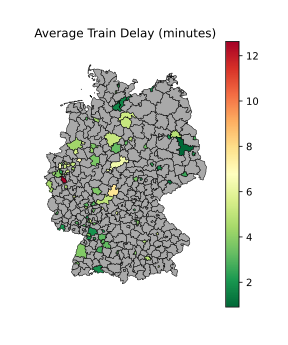
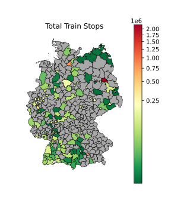

# Analysis of Train Delays in Germany and Switzerland

This project aims to integrate one year worth of train and weather data from Germany and Switzerland and tries to analyse the relation between weather events such as precipitation, wind, and temperature and train delays and cancelations. For an in-depth description on how data was gained, integrated, and analysed please see the report under report/g5_final_report.pdf.

## Outlook on our findings

In this section we will show some results that we've obtained to further show what we have done.

